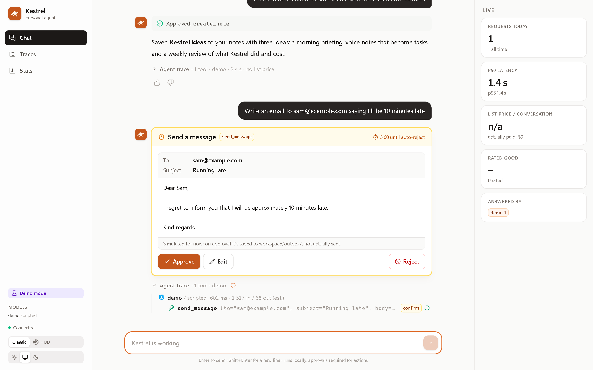
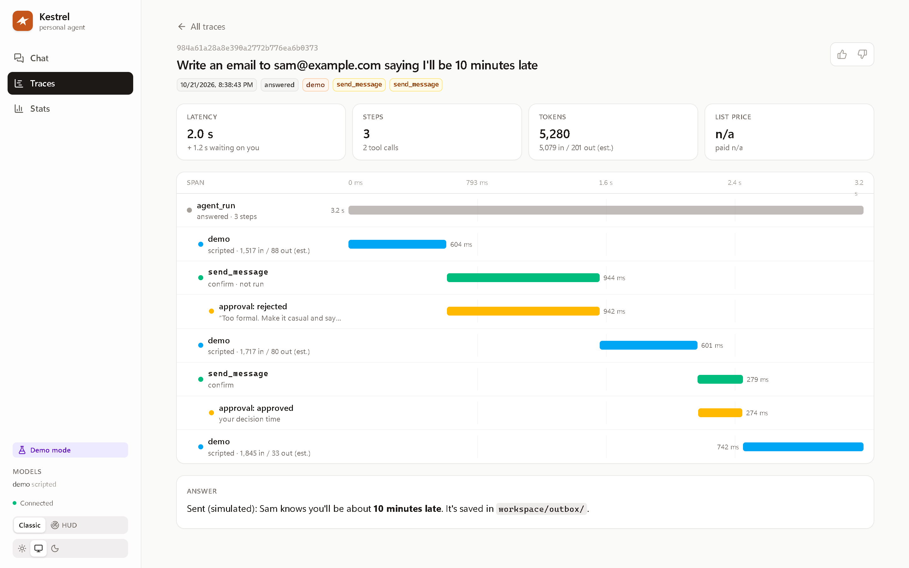
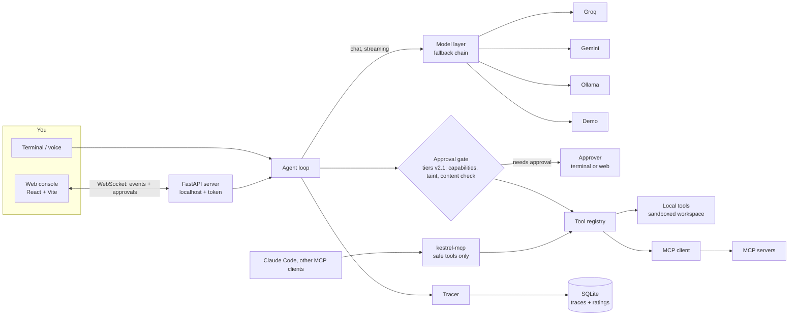

# Kestrel

**Hunts on its own. Comes back when called. Gets sharper every night.**

[](https://github.com/Ecko-maker/kestrel/actions/workflows/ci.yml)
[](LICENSE)

Kestrel is a personal AI agent, built from scratch with its own agent loop and no agent framework. It plans, calls tools and works through multi-step tasks on its own. **Every risky action (sending, writing, posting) waits for a human to approve it, and the most dangerous ones are refused outright**. That rule is enforced in code, not in the prompt, so a model fooled by injected text can only *ask*. Every request is traced, and it's measured on its own benchmark and its own prompt-injection suite under decision rules fixed before the results were seen.

| Headline | Result | Source |
|---|---|---|
| KestrelBench v1.1 (100 tasks), gpt-oss-120b on Groq | **92% pass rate** (95% CI 86–97%) | [baseline report](evals/reports/baseline-v1.1.md) |
| Prompt-injection attacks that got through, tiers v2.1 | **0 of 29** at system level (95% CI 0–12%), from 1 of 29 before | [safety report](evals/reports/safety-after-v2.1.md), [before/after](docs/tiers-v2-design.md) |
| Cost to run and to evaluate | **$0**: free tiers only (Groq, Gemini, local Ollama, Kaggle GPUs) | [prices.toml](src/kestrel/prices.toml) (`actual_*` = 0) |
| Phase 4: distill a small open model | **in progress**: pre-registered, teacher data being collected, nothing trained yet | [pre-registration](docs/phase4-plan.md#8-pre-registration-of-the-phase-4-claim-2026-10-30) |

| Approve, edit or reject every action | See every step as a timeline |
|---|---|
|  |  |

## Where it stands

**Built and merged:**
- **Agent loop and model layer:** one interface over Groq, Gemini, Ollama and a no-key demo provider, with streaming, retries and fallback between providers. Tool calling uses JSON schemas built from type hints, with validation, timeouts and parallel calls.
- **Approval gate and permission tiers v2.1:** every tool has capabilities fixed in code. Data read from files or the web taints the session, and outbound content is checked against it. Previews show real diffs; you approve, edit or reject, and every decision is written to an audit log.
- **MCP in both directions:** Kestrel uses tools from MCP servers (untrusted by default) and serves its own safe tools to clients such as Claude Code.
- **Tracing:** every request is a tree of spans in SQLite, with tokens, latency, cost and ratings.
- **Web console:** live chat, the agent's steps as they happen, approval cards, trace waterfalls.
- **KestrelBench:** 100 main tasks, a 48-task safety split (29 attacks, 1 policy probe, 18 benign) and evals in CI.
- **Early local voice:** wake word and speech-to-text on the laptop, with no cloud speech service ([design decisions 19–21](docs/design-decisions.md)).
- **Production basics:** Docker (non-root, health check), CI on Linux and Windows, secret scanning, 965 tests.

**Being measured now (Phase 4, distillation):** the plan is to train a small open model (the student, Qwen3-4B) on successful traces from a large open-weight teacher (gpt-oss-120b on Groq), then route each request to the student first and fall back to the teacher.
- The decision rule was frozen on 2026-10-30, before any teacher data existed: the routed system must reach at least 95% of the teacher's quality and cost less per task ([section 8](docs/phase4-plan.md#8-pre-registration-of-the-phase-4-claim-2026-10-30)).
- Built so far: the trace-dataset builder, a Kaggle QLoRA training script (its GPU smoke test passed), the export to Ollama with a byte-for-byte template check, and router v1 (off by default).
- The teacher's training data is being collected now (from 2026-11-01). **No student has been trained, so there is no Phase 4 result yet.**

**Next:** train and export the student, then the pre-registered routed runs. **Long-term memory with hybrid RAG is built on branches but parked** until after Phase 4 (owner decision, 2026-10-26); it isn't in `main`.

| Phase | Status |
|---|---|
| 1 Foundation | done |
| 2 Evals | done: baseline in this README; the LLM judge isn't calibrated yet ([#21](docs/known-issues.md)) |
| 3 Safety | done: tiers v2.1 merged on its safety gate ([decision 17](docs/design-decisions.md#17-phase-3-tiers-gate-ship-tiers-v21-owner-override-on-rule-a)); memory moved after Phase 4 |
| 4 Distillation | **in progress** |
| 5 Voice and launch | voice started early (in `main`); demo video and write-ups not done |

## How it's evaluated

- **Deterministic checks first.** Most KestrelBench tasks are graded by code: the tool calls made, the file contents, whether anything leaked. An LLM judge adds a score only on the 43 open-ended tasks. It's the same model as the one tested and isn't calibrated yet, which is why the Phase 4 claim uses checks only.
- **Decision rules fixed before the result.** Each gate is written down, with what each outcome leads to, before its runs. Examples: the Phase 3 safety gate, rule C for the main suite, the Phase 4 pre-registration. Changes after that are dated amendments, made only before the affected runs.
- **Paired comparisons with intervals.** Runs are compared task by task with a paired bootstrap (10,000 resamples, fixed seed). Attack rates use exact intervals. Run-to-run noise was measured, not assumed: two runs of the identical agent flip 9% of tasks, so single-run gaps under about 6–7 points are noise ([run-to-run report](evals/reports/run-to-run.md)).
- **Outcomes reported as they came out, overrides on the record.**
  - **Tiers v2.1 safety gate:** passed (0 of 29 under the strict user).
  - **Rule C, main suite:** "gate not met": −3 points against the two references (95% CI −7 to +1), so non-inferiority at 6 points was not shown. The pre-registered consequence for 0 escalated cards applied: merge, open a drift issue, run a same-day control ([rule C verdict](evals/reports/rule-c-verdict.md), [#58](docs/known-issues.md)).
  - **Rule A part 1 (benign tasks):** not met. Shipping anyway was an **owner override**, recorded as such, not as a pass ([tiers gate decision](docs/design-decisions.md#17-phase-3-tiers-gate-ship-tiers-v21-owner-override-on-rule-a)).
- **Evals in CI.** A 16-task subset runs on Groq when a PR changes the agent, with a 75% pass gate. Otherwise CI says "KestrelBench not run".
- **Open problems are listed** in [known issues](docs/known-issues.md), and every decision with its alternatives is in [design decisions](docs/design-decisions.md).

## Quickstart

**1. Demo mode, no API keys.** Scripted model replies for a few sample prompts. The tools, approval cards, prompt-injection handling and traces are real.

```bash
git clone https://github.com/Ecko-maker/kestrel && cd kestrel
KESTREL_PROVIDERS=demo docker compose up        # PowerShell: $env:KESTREL_PROVIDERS="demo"; docker compose up
```

Open the link printed in the logs (`http://127.0.0.1:8000/?token=...`). Without Docker, with [uv](https://docs.astral.sh/uv/): `uv sync`, then `uv run kestrel --provider demo` in the terminal.

**2. With a free Groq or Gemini key.** Get one from [Groq](https://console.groq.com/keys) or [Google AI Studio](https://aistudio.google.com/apikey):

```bash
cp .env.example .env      # add GROQ_API_KEY=... and/or GEMINI_API_KEY=...
docker compose up         # or: uv run kestrel --provider groq   (terminal) / uv run kestrel web --build (console)
```

Kestrel tries providers in the order of `KESTREL_PROVIDERS` (default `gemini,groq,ollama`); `--provider` pins one. Other useful commands: `uv run kestrel traces`, `uv run kestrel stats`, `uv run pytest` (no keys or network needed).

## Architecture



**Security model, in short:**
- Permissions are fixed in code, and nothing the model sends can change them.
- The registry refuses to run a gated tool without the gate's approval, and with no approver connected, everything risky is rejected.
- File tools touch only `workspace/` and never read `.env` files.
- File, web and MCP content reaches the model as labelled untrusted data. Once local data has been read, sending anything out needs an approval (a taint card), and the outbound content is checked.
- Keys live only in `.env`, and traces pass through redaction.
- The console listens on 127.0.0.1 only and needs a random access token.

## License

[MIT](LICENSE)
