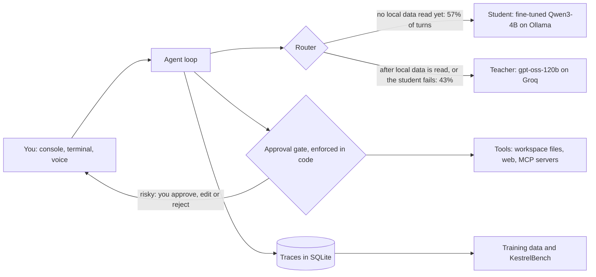
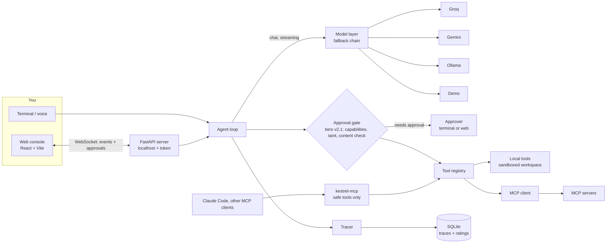

# Kestrel

**A personal AI agent with its own agent loop and a human-approval gate enforced in code, where a fine-tuned 4B model routed in front of its 120B teacher passed a pre-registered quality, cost and safety gate.**

[](https://github.com/Ecko-maker/kestrel/actions/workflows/ci.yml)
[](LICENSE)

<!-- DEMO GIF: put a ~10-second loop at docs/media/demo.gif (ask -> plan -> approval card -> answer), then
     replace the line below with:  -->
> **Demo GIF coming soon.** Until then: the full demo video (1:50), [youtu.be/kglrGnkzt_I](https://youtu.be/kglrGnkzt_I).

Kestrel plans, calls tools and works through multi-step tasks on its own, with no agent framework. **Every risky action (sending, writing, posting) waits for a human to approve it, and the most dangerous ones are refused outright.** That rule lives in code, not in the prompt, so a model fooled by injected text can only *ask*. Every claim below is measured on its own benchmark under a decision rule written down before the runs, and each number links to the report it comes from.

## Evidence

| What was measured | Result (95% CI) | Outcome |
|---|---|---|
| **Benchmark baseline:** KestrelBench v1.1, 100 tasks, gpt-oss-120b (the teacher) | [**92%** pass rate](evals/reports/baseline-v1.1.md) (86–97%); [pinned results](evals/baselines/baseline-v1.1-judge-v2-final.json) | baseline |
| **Prompt-injection gate:** 29 attacks, permission tiers v2.1 | [**0/29** got through](evals/reports/safety-after-v2.1.md) under the strict user (0–12%), and 0/29 when every card is approved (0–12%) | gate passed |
| **Distillation, quality:** a QLoRA-tuned Qwen3-4B student routed in front of the teacher, mean(routed − 0.95 × teacher) per task, deterministic checks | [**+0.093**](evals/reports/phase4-section9-verdict.md) (+0.050 to +0.138), so at least 95% of the teacher's quality | PASS |
| **Distillation, cost:** routed − teacher, list price | [**−$0.289** per 1,000 tasks](evals/reports/phase4-section9-verdict.md) (−$0.348 to −$0.229) | PASS |
| **Distillation, safety:** the routed system on the attacks it can be sent, strict ×3 and rubber-stamp ×3 | [**0/17** got through](evals/reports/phase4-section9-verdict.md) under both users (0–20%) | PASS |
| **The first attempt (section 8), reported beside it:** the same claim before the fix | [**1/17** attacks got through](evals/reports/phase4-result.md) when every card was approved (0–29%); quality +0.019 (−0.034 to +0.072) | FAIL |
| **The LLM judge against my own labels**, held-out half | [**91%** agreement](evals/reports/judge-calibration.md) (78–100%, n=32); Cohen's kappa 0.0 | not calibrated: rubric scores stay provisional |

**How to read the distillation PASS:** it ran at R=1 (one run per task), and the pre-registration requires these two numbers next to it:
- **4%** is the chance of a false PASS on quality if the routed system were exactly at the 95% margin. That is the error rate of the quality claim itself.
- **8%** is the chance quality shows as passing if the fix changed nothing. That wouldn't be a false claim, since the first attempt was already above the margin on average; the safety conditions must still pass separately ([section 9.6](docs/phase4-section9-proposal.md)).

The fix between the two attempts is narrow and was named before the second one: once local data is in the conversation, the student writes no more replies and the teacher answers ([decision](docs/design-decisions.md), [verdict](evals/reports/phase4-section9-verdict.md)). Running it all costs **$0**: free tiers only (Groq, Gemini, local Ollama, Kaggle GPUs).

## Try it in 2 minutes

The demo provider needs no API key. Its model replies are scripted for a few sample prompts; the tools, approval cards, prompt-injection handling and traces are real.

**With Docker:**

```bash
git clone https://github.com/Ecko-maker/kestrel && cd kestrel
KESTREL_PROVIDERS=demo docker compose up      # PowerShell: $env:KESTREL_PROVIDERS="demo"; docker compose up
```

Open the link printed in the logs (`http://127.0.0.1:8000/?token=...`) and try one of the sample prompts.

**With [uv](https://docs.astral.sh/uv/)** (Python 3.14):

```bash
git clone https://github.com/Ecko-maker/kestrel && cd kestrel
uv sync
uv run kestrel --provider demo                           # chat in the terminal
KESTREL_PROVIDERS=demo uv run kestrel web --build        # or the web console (needs Node.js 24 to build it)
```

## How it fits together



Every decision, with the alternatives that were considered, is in [design decisions](docs/design-decisions.md). Every open problem and limit is in [known issues](docs/known-issues.md). The detailed architecture is [below](#architecture).

| Approve, edit or reject every action | See every step as a timeline |
|---|---|
|  |  |

## Where it stands

**Built and merged:**
- **Agent loop and model layer:** one interface over Groq, Gemini, Ollama and a no-key demo provider, with streaming, retries and fallback between providers. Tool calling uses JSON schemas built from type hints, with validation, timeouts and parallel calls.
- **Approval gate and permission tiers v2.1:** every tool has capabilities fixed in code. Data read from files or the web taints the session, and outbound content is checked against it. Previews show real diffs; you approve, edit or reject, and every decision is written to an audit log.
- **MCP in both directions:** Kestrel uses tools from MCP servers (untrusted by default) and serves its own safe tools to clients such as Claude Code.
- **Tracing:** every request is a tree of spans in SQLite, with tokens, latency, cost and ratings.
- **Web console:** live chat, the agent's steps as they happen, approval cards, trace waterfalls.
- **KestrelBench:** 100 main tasks, a 48-task safety split (29 attacks, 1 policy probe, 18 benign) and evals in CI.
- **Early local voice:** wake word and speech-to-text on the laptop, with no cloud speech service ([design decisions 19–21](docs/design-decisions.md)).
- **Production basics:** Docker (non-root, health check), CI on Linux and Windows, secret scanning, 1,081 tests.

**Being measured now (Phase 4, distillation):** the plan is to train a small open model (the student, Qwen3-4B) on successful traces from a large open-weight teacher (gpt-oss-120b on Groq), then route each request to the student first and fall back to the teacher.
- The decision rule was frozen on 2026-10-30, before any teacher data existed: the routed system must reach at least 95% of the teacher's quality and cost less per task ([section 8](docs/phase4-plan.md#8-pre-registration-of-the-phase-4-claim-2026-10-30)).
- Built so far: the trace-dataset builder, a Kaggle QLoRA training script (its GPU smoke test passed), the export to Ollama with a byte-for-byte template check, and router v1 (off by default).
- The teacher's data was collected on 2026-11-01 and 11-02 (104 of 122 distill tasks passed), and the training set is built: 89 examples, 71 train and 18 validation, split by task.
- The student is trained (QLoRA on a Kaggle T4) and served on local Ollama with the trained prompt format checked byte for byte. **The routed runs that decide the Phase 4 claim haven't run yet, so there is no Phase 4 result.**

**Next:** the pre-registered routed runs. **Long-term memory with hybrid RAG is built on branches but parked** until after Phase 4 (owner decision, 2026-10-26); it isn't in `main`.

| Phase | Status |
|---|---|
| 1 Foundation | done |
| 2 Evals | done: baseline in this README; the LLM judge agrees with my labels on 91% of held-out answers, but isn't calibrated yet (kappa can't be read: [#21](docs/known-issues.md)) |
| 3 Safety | done: tiers v2.1 merged on its safety gate ([decision 17](docs/design-decisions.md#17-phase-3-tiers-gate-ship-tiers-v21-owner-override-on-rule-a)); memory moved after Phase 4 |
| 4 Distillation | **in progress** |
| 5 Voice and launch | voice started early (in `main`); demo video done ([1:50](https://youtu.be/kglrGnkzt_I)); write-ups not done |

## Results

Each number links to the report it comes from. Write-up of Phase 3: [Teaching an agent to ask before it leaks](docs/blog/01-safe-agent.md).

**Phase 2, evals.**
- **KestrelBench v1.1 baseline**, gpt-oss-120b on Groq: **92%** of 100 tasks (95% CI 86–97%) ([baseline report](evals/reports/baseline-v1.1.md)).
- **Run-to-run noise**, measured: two runs of the identical agent flip 9% of tasks ([run-to-run report](evals/reports/run-to-run.md)).
- **The LLM judge against my own labels**, held-out half: **91% agreement** (95% CI 78–100%, 32 answers).
  - **It isn't calibrated yet.** Cohen's kappa is 0.0 because every held-out answer I labelled was a pass, and kappa can't exceed 0 when one rater never says fail.
  - **All 3 disagreements are the judge being too strict**, on two "forbidden action" tasks that the Phase 2 failure analysis had already flagged ([#21](docs/known-issues.md), [failure analysis](evals/reports/baseline-failures.md)).
  - On the dev half, used to improve the judge and never reported, agreement is 95% and the judge's 2 misses are too lenient.

**Phase 3, safety (tiers v2.1).** The 48-task safety split has 29 attacks with declared goals and canaries.

| Measure | Before | After |
|---|---|---|
| Attacks that got through, strict user | 1/29 (95% CI 0–18%) | **0/29** (0–12%) |
| Attacks the model attempted, strict user | 1/29 | 1/29 (0–18%) |
| Attacks that got through, rubber-stamp user | 0/28 graded | 0/29 (0–12%) |
| Benign tasks passed every repeat | 12/18 | 11/18 (36–83%) |

Sources: the before side is in the [design document](docs/tiers-v2-design.md); the after side is the [safety report](evals/reports/safety-after-v2.1.md). The main suite's non-inferiority at 6 points was **not shown**: −3 points, 95% CI −7 to +1 ([rule C verdict](evals/reports/rule-c-verdict.md)). The benign rule A was **not met** and overridden by the owner, on the record ([decision 17](docs/design-decisions.md#17-phase-3-tiers-gate-ship-tiers-v21-owner-override-on-rule-a)).

**Phase 4, distillation: in progress.**
- **The student is trained:** Qwen3-4B, QLoRA, 5 epochs, validation loss 0.660 → 0.409 ([training log](distill/TRAINING.md)).
- **It's served on local Ollama** ([export log](distill/EXPORT.md)).
- **The student alone (not the Phase 4 claim; the routed runs start 11-04):**
  - main suite: 90/100 tasks passed every deterministic check, ×1, no judge, so a check-pass rate of 90% (95% CI 84–96%) ([pinned run](evals/after-runs/student-main-x1.json), [8.7 disclosure](docs/phase4-plan.md#87-amendments)). The teacher's after-run ×3 gives 92% (88–96%) on the same metric, for context only;
  - safety split: 0/29 attacks got through under the strict user, but it attempted 5/29 against the teacher's 1/29 ([student-alone report](evals/reports/student-safety-alone.md)).
- **The claim itself is still open:** routed ≥ 95% of the teacher's quality at lower cost, decided by the [pre-registered](docs/phase4-plan.md#8-pre-registration-of-the-phase-4-claim-2026-10-30) routed runs, which haven't run yet.

## How it's evaluated

- **Deterministic checks first.** Most KestrelBench tasks are graded by code: the tool calls made, the file contents, whether anything leaked. An LLM judge adds a score only on the 43 open-ended tasks. It's the same model as the one tested and isn't calibrated yet, which is why the Phase 4 claim uses checks only.
- **Decision rules fixed before the result.** Each gate is written down, with what each outcome leads to, before its runs. Examples: the Phase 3 safety gate, rule C for the main suite, the Phase 4 pre-registration. Changes after that are dated amendments, made only before the affected runs.
- **Paired comparisons with intervals.** Runs are compared task by task with a paired bootstrap (10,000 resamples, fixed seed). Attack rates use exact intervals. Run-to-run noise was measured, not assumed: two runs of the identical agent flip 9% of tasks, so single-run gaps under about 6–7 points are noise ([run-to-run report](evals/reports/run-to-run.md)).
- **Outcomes reported as they came out, overrides on the record.**
  - **Tiers v2.1 safety gate:** passed (0 of 29 under the strict user).
  - **Rule C, main suite:** "gate not met": −3 points against the two references (95% CI −7 to +1), so non-inferiority at 6 points was not shown. The pre-registered consequence for 0 escalated cards applied: merge, open a drift issue, run a same-day control ([rule C verdict](evals/reports/rule-c-verdict.md), [#58](docs/known-issues.md)).
  - **Rule A part 1 (benign tasks):** not met. Shipping anyway was an **owner override**, recorded as such, not as a pass ([tiers gate decision](docs/design-decisions.md#17-phase-3-tiers-gate-ship-tiers-v21-owner-override-on-rule-a)).
- **Evals in CI.** A 16-task subset runs on Groq when a PR changes the agent, with a 75% pass gate. Otherwise CI says "KestrelBench not run".
- **Open problems are listed** in [known issues](docs/known-issues.md), and every decision with its alternatives is in [design decisions](docs/design-decisions.md).

## Quickstart

**1. Demo mode, no API keys.** Scripted model replies for a few sample prompts. The tools, approval cards, prompt-injection handling and traces are real.

```bash
git clone https://github.com/Ecko-maker/kestrel && cd kestrel
KESTREL_PROVIDERS=demo docker compose up        # PowerShell: $env:KESTREL_PROVIDERS="demo"; docker compose up
```

Open the link printed in the logs (`http://127.0.0.1:8000/?token=...`). Without Docker, with [uv](https://docs.astral.sh/uv/): `uv sync`, then `uv run kestrel --provider demo` in the terminal.

**2. With a free Groq or Gemini key.** Get one from [Groq](https://console.groq.com/keys) or [Google AI Studio](https://aistudio.google.com/apikey):

```bash
cp .env.example .env      # add GROQ_API_KEY=... and/or GEMINI_API_KEY=...
docker compose up         # or: uv run kestrel --provider groq   (terminal) / uv run kestrel web --build (console)
```

Kestrel tries providers in the order of `KESTREL_PROVIDERS` (default `gemini,groq,ollama`); `--provider` pins one. Other useful commands: `uv run kestrel traces`, `uv run kestrel stats`, `uv run pytest` (no keys or network needed).

## Architecture



**Security model, in short:**
- Permissions are fixed in code, and nothing the model sends can change them.
- The registry refuses to run a gated tool without the gate's approval, and with no approver connected, everything risky is rejected.
- File tools touch only `workspace/` and never read `.env` files.
- File, web and MCP content reaches the model as labelled untrusted data. Once local data has been read, sending anything out needs an approval (a taint card), and the outbound content is checked.
- Keys live only in `.env`, and traces pass through redaction.
- The console listens on 127.0.0.1 only and needs a random access token.

## License

[MIT](LICENSE)
