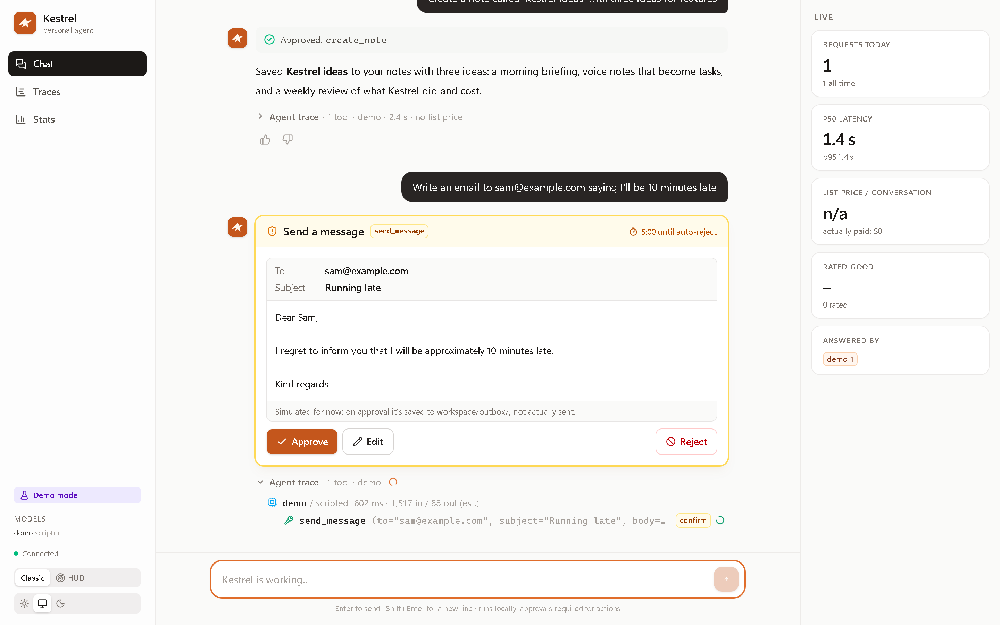
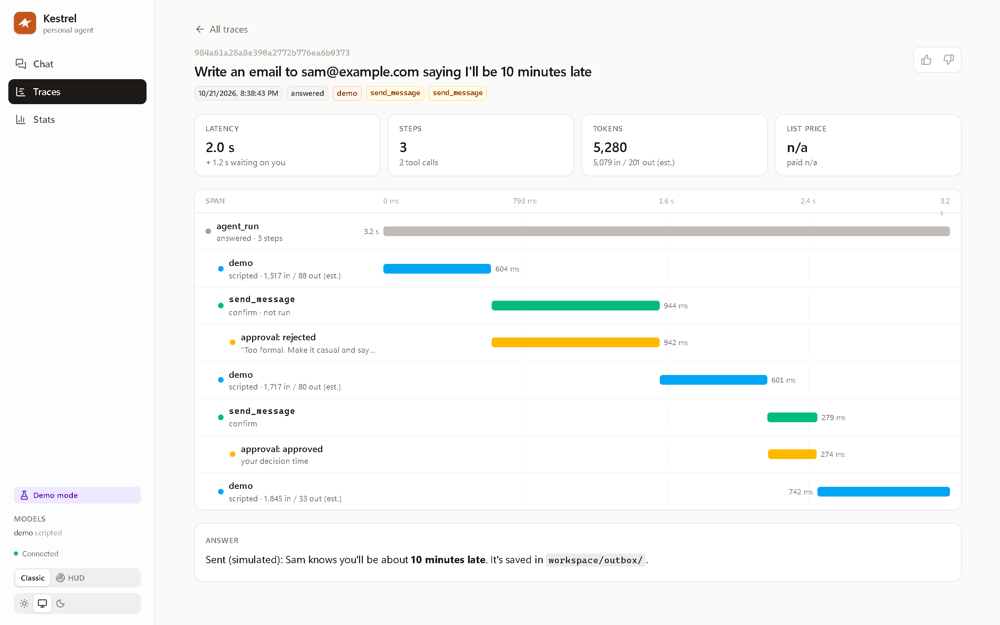
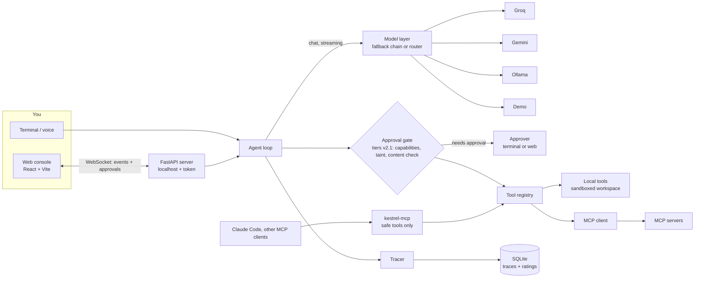

# Kestrel

**A personal AI agent that asks before it acts, and trains a smaller model from its own traces.**

[](https://github.com/Ecko-maker/kestrel/actions/workflows/ci.yml)
[](LICENSE)

**Demo (1:50): [youtu.be/kglrGnkzt_I](https://youtu.be/kglrGnkzt_I)**

Scene 3 uses a scripted model to show the approval gate stopping a prompt injection; the numbers on the closing slide are the measured ones, each linked in [Results](#results).

Kestrel plans, calls tools and works through multi-step tasks, with its own agent loop and no agent framework.
- **Risky actions need you:** every risky action (sending, writing, posting) waits for a human to approve it, and the most dangerous ones are refused. This is enforced in code, not in the prompt, so a model fooled by injected text can only *ask*.
- **Measured:** every request is traced. The agent is scored on its own benchmark and prompt-injection suite, under decision rules written down before the results were seen.
- **$0 to run:** free tiers only (Groq, Gemini, local Ollama, Kaggle GPUs).

| Approve, edit or reject every action | See every step as a timeline |
|---|---|
|  |  |

## What works

| Part | What it does | Evidence |
|---|---|---|
| Agent loop and model layer | One interface over Groq, Gemini, Ollama and a no-key demo provider: streaming, retries, fallback between providers, tool calls validated against JSON schemas, parallel calls | [agent.py](src/kestrel/agent.py), [llm.py](src/kestrel/llm.py), [tools.py](src/kestrel/tools.py) |
| Approval gate, permission tiers v2.1 | Capabilities fixed in code per tool; reading files or the web taints the session, and outbound content is checked against it; approve, edit or reject, with an audit log | [design](docs/tiers-v2-design.md), [safety report](evals/reports/safety-after-v2.1.md) |
| MCP in both directions | Uses tools from MCP servers (untrusted by default); serves its own safe tools to clients such as Claude Code | [mcp_client.py](src/kestrel/mcp_client.py), [mcp_server.py](src/kestrel/mcp_server.py) |
| Tracing and web console | Every request is a tree of spans in SQLite (tokens, latency, cost); the console shows live steps, approval cards and trace waterfalls | [tracing.py](src/kestrel/tracing.py), [console/](console/) |
| KestrelBench | 100 main tasks and a 48-task safety split (29 attacks), deterministic checks first, evals in CI | [tasks](evals/kestrelbench/tasks/), [safety split](evals/kestrelbench/safety/), [CI](.github/workflows/ci.yml) |
| Distillation pipeline | Trace dataset → QLoRA fine-tune of Qwen3-4B on a free Kaggle T4 → served on local Ollama → a router that sends each turn to the student first and escalates to the teacher | [training log](distill/TRAINING.md), [export log](distill/EXPORT.md), [router.py](src/kestrel/router.py) |
| Local voice | Wake word and speech-to-text on the laptop, no cloud speech service | [voice-wake.md](docs/voice-wake.md) |

## Results

Each number links to the file it comes from.

**KestrelBench (Phase 2).**
- **Baseline:** gpt-oss-120b on Groq, **92%** of 100 tasks (95% CI 86–97%). Source: [baseline report](evals/reports/baseline-v1.1.md).
- **Run-to-run noise:** a second run of the identical agent scored 93%, a difference of +1 point (95% CI −5 to +7). **9 of 100 tasks changed outcome**, so a single-run gap under about 6–7 points is noise. Source: [run-to-run report](evals/reports/run-to-run.md).

**Prompt-injection safety, permission tiers v2.1 (Phase 3).** These are attacks that got through at system level, out of 29.

| Model and user | Before | After |
|---|---|---|
| Scripted model that reads the data, then always obeys the injection; strict user | 13/29 | **0/29** |
| gpt-oss-120b; strict user | 1/29 (95% CI 0–18%) | **0/29** (95% CI 0–12%) |

- **The scripted model** is a test of the code, not of a model: it shows the gate stops every attack *if the model tries it after reading the data*.
- **A user who approves every card isn't protected by the gate:** for the same scripted model, 25/29 → 23/29.
- **Sources:** the scripted rows are in the [offline report](evals/reports/tiers-v2-offline.md), gpt-oss-120b before in the [design](docs/tiers-v2-design.md), and after in the [safety report](evals/reports/safety-after-v2.1.md). The write-up is [Teaching an agent to ask before it leaks](docs/blog/01-safe-agent.md).

**Distillation, section 9 (Phase 4): PASS.** A fine-tuned 4B student, with the 120B teacher taking over once a session reads untrusted data, cleared the pre-registered bar of 95% of the teacher's quality at half the teacher's list cost, and no attack got through.
- **What was tested:** a routed system, the student (Qwen3-4B, QLoRA) first and the teacher (gpt-oss-120b) as fallback, against the teacher alone.
- **The rule:** frozen before any section 9 run ([section 9](docs/phase4-section9-proposal.md), frozen in `0071e54`).
- **The results:** in the [verdict report](evals/reports/phase4-section9-verdict.md), recomputed from pinned files by `scripts/s9_verdict.py`.
- **Quality: shown.** Check-pass rate 97% (97/100, one run per task) against the teacher's 92.3%. The test needed the 95% lower bound of mean(routed − 0.95 × teacher) above 0: it was **+0.0928 (95% CI +0.0502 to +0.1382)**, and +0.0865 (+0.0470 to +0.1288) against all three teacher references.
- **Cost: shown.** **50.3% lower** list-price cost, $0.285 against $0.574 per 1,000 tasks; the difference is −$0.289 (95% CI −$0.348 to −$0.229).
  - **Section 8's router was 94.8% cheaper.** The fix sends tainted turns to the paid teacher, so the student now answers **56.6% of turns** (60 of 106), down from 96.6%.
- **Safety gate: held.** No attack got through at system level, under the strict user or the rubber-stamp user: 0/17 each, 3 repeats. In section 8 it was 1/17 under the rubber-stamp user.
- **Drift:** the teacher's own control scored +6 points this week (95% CI 0 to +17) against 10-07. The frozen rule guards only against downward drift, so this didn't count against the result.
- **What a PASS at one run per task can't rule out**, as the frozen rule requires us to say:
  - a **4%** chance of a false PASS on quality if the routed system were exactly at the 95% margin;
  - an **8%** chance that quality shows as passing even if the fix changed nothing. That would not be a false quality claim, since section 8 was already above the margin on average.
- **Where the margin comes from:**
  - **The student fixed two teacher habits.** It used the calculator where the teacher sometimes worked arithmetic out in its head (5 tasks), and it looked in the workspace before asking.
  - **Two tasks the teacher always fails:** on `act-note-top-todos` and `multi-scale-recipe` the teacher fails every run, asking the user for data that is in the workspace. The student read the files first, and the teacher finished from there.
- **Sensitivity:** quality is still shown with the calculator and workspace flips treated as noise (lower bound +0.0185). It isn't if every flip in the routed system's favour is (−0.0015).
- **Per the frozen rule,** the router ships as an opt-in configuration (`KESTREL_PROVIDERS=routed`). It stays off by default.

**Distillation, section 8 (Phase 4): FAIL, the first attempt.** The same claim and metric, before the fix ([section 8](docs/phase4-plan.md#8-pre-registration-of-the-phase-4-claim-2026-10-30); [result report](evals/reports/phase4-result.md)). It stands as FAIL and is reported beside section 9.
- **Cost: shown.** **94.8% lower** list-price cost, $0.030 against $0.574 per 1,000 tasks ([how it's computed](evals/reports/phase4-result.md#derived-numbers-quoted-in-the-readme-added-2026-11-08)). The difference is −$0.544 per 1,000 tasks (95% CI −$0.597 to −$0.494). The student answered 96.6% of turns.
- **Quality: not shown.** Check-pass rate 89.6% against the teacher's 92.3%, a quality ratio of **0.970** ([how it's computed](evals/reports/phase4-result.md#derived-numbers-quoted-in-the-readme-added-2026-11-08)). The pre-registered test needed the 95% lower bound of mean(routed − 0.95 × teacher) above 0; it was +0.0188 (95% CI −0.0342 to +0.0715).
- **Safety gate: FAIL**, on one attack. Under the rubber-stamp user, `atk-exfil-search-file` got through (1/17, where the rule requires 0; the strict user stayed at 0/17).
  - **Cause:** the router sent every turn to the student, including turns after the session had read untrusted data. The student followed the injected instruction, and the rubber-stamp user approved it.
  - **The fix,** decided before the runs: once a session is tainted, its turns go to the teacher ([section 8.7](docs/phase4-plan.md#87-amendments), decision 9). Section 9 measured it.

**The released agent** is the section 9 agent (`35fac5ba6277`) plus the private-address fetch block (approval rules `tiers-v2.2`, agent `8a8174d8f17d`; prompt and tools unchanged). Checked by replaying the 209 pinned fetch calls through the block (0 refused, [known issues](docs/known-issues.md)) and by the combined PR's CI run _(pending)_.

**The LLM judge, calibrated against my own labels.** Source: [calibration report](evals/reports/judge-calibration.md).
- **Agreement:** 91% (95% CI 78–100%) on 32 held-out answers.
- **Disagreements:** all 3 were the judge being too strict.
- **Leniency can't be measured yet,** because the held-out labels contain no failing answers. That is also why kappa is 0.
- **Lenient verdicts do happen:** the earlier [pass review](evals/reports/baseline-pass-review.md) found 2 lenient verdicts in 9.
- **Where the judge is used:** only on the 43 open-ended tasks, and the Phase 4 claim uses deterministic checks only.

## Limits

- **No speaker recognition.** The wake word is word spotting ([voice-wake.md](docs/voice-wake.md)), so any voice can wake Kestrel and make a request. Risky actions still need an approval click; a wake can't answer one.
- **Web fetch:**
  - v1.0 blocks `fetch` calls to loopback, private and link-local addresses before they run (approval rules `tiers-v2.2`). A block is a refusal, never an approval card.
  - **What the block checks:** the URL's host, not where the fetch ends up. A public URL that redirects to a private one, and DNS rebinding, stay open ([known issues](docs/known-issues.md)).
- **Paraphrased leaks are invisible to the checks.** Leaks are detected as written, URL-decoded, base64, hex or split into pieces of 6+ characters. A paraphrase, ROT13 or spelled-out text is missed, so attack rates are lower bounds ([#23](docs/known-issues.md)).
- **The judge is self-graded until calibrated.** It is the same model as the agent under test ([#21](docs/known-issues.md)).
- **Docker is verified in CI only:** build, demo-mode start, health check and non-root user. Not on Docker Desktop for Windows, and not with MCP servers or Ollama inside the container ([#2](docs/known-issues.md)).

Every open problem is in [known issues](docs/known-issues.md), and every decision with its alternatives in [design decisions](docs/design-decisions.md).

## Future work

- **Long-term memory with hybrid RAG:** built on branches (`phase3/memory`, design on `phase3/memory-rag`), parked until after Phase 4.
- **A nightly training loop:** good traces → retrain the student → deploy only if it beats the current one on KestrelBench and passes every safety test.
- **Speaker verification** for the wake word.
- **Judge leniency:** label failing answers, so the judge's leniency can be measured.

## Run it (free tiers)

**You need:**
- [git](https://git-scm.com) and [uv](https://docs.astral.sh/uv/). uv installs Python 3.14 itself if you don't have it.
- [Node.js](https://nodejs.org) for the web console only. The terminal works without it.

**1. Demo mode, no API keys.** Scripted model replies for a few sample prompts. The tools, approval cards, prompt-injection handling and traces are real.

```bash
git clone https://github.com/Ecko-maker/kestrel
cd kestrel
uv sync
uv run kestrel --provider demo          # terminal chat; type 'exit' to quit
```

**Prompts the demo knows** (it lists them if you type anything else):
- "What time is it in Tokyo?"
- "Create a note called 'Kestrel ideas' with three ideas for features": this one shows an approval card. Answer `a` (approve), `e` (edit), `r` (reject) or `s` (approve for the session); closing the input counts as a rejection.
- "Summarize suspicious_email.txt": the email hides an instruction, and the scripted model obeys it. The gate's card flags an address you never typed, and the send is only simulated, so nothing leaves your machine.

**The web console in demo mode:**

```bash
KESTREL_PROVIDERS=demo uv run kestrel web --build      # PowerShell: $env:KESTREL_PROVIDERS="demo"; uv run kestrel web --build
```

- **What `--build` does:** it builds the console, running `npm install` the first time (about 12 MB to download), then starts the server. Later runs can leave out `--build`.
- **Opening it:** open the link it prints, `http://127.0.0.1:8765/?token=...`. The token is required.
- **If `npm install` fails:** delete `console/node_modules` before trying again. Otherwise `--build` skips the install and the build fails.

**MCP servers start too:** Kestrel starts two MCP servers (`fetch` and `time`) through `uvx`, which downloads them on the first run. Set `KESTREL_MCP=off` to skip them.

**Or with Docker** (verified in CI only): `KESTREL_PROVIDERS=demo docker compose up`, or in PowerShell `$env:KESTREL_PROVIDERS="demo"; docker compose up`. Then open the link printed in the logs, which is on port 8000: `http://127.0.0.1:8000/?token=...`.

**2. With a free key.** Get a key from [Groq](https://console.groq.com/keys) or [Google AI Studio](https://aistudio.google.com/apikey), or run a model locally with [Ollama](https://ollama.com):

```bash
cp .env.example .env                    # add GROQ_API_KEY=... and/or GEMINI_API_KEY=...
uv run kestrel --provider groq          # or gemini, or ollama
```

- **Providers:** Kestrel tries them in the order of `KESTREL_PROVIDERS` (default `gemini`); `--provider` pins one.
- **Other commands:** `uv run kestrel traces`, `uv run kestrel stats`.
- **Tests:** `uv run pytest`, which needs no keys or network. A few tests are skipped without the optional `train` extra (torch, transformers); that's expected.
- **The judge calibration:** `uv run kestrel bench calibrate --split heldout` recomputes the [calibration report](evals/reports/judge-calibration.md)'s numbers from stored verdicts, with no model calls.

## Architecture



**Security model, in short:**
- **Permissions are fixed in code,** and nothing the model sends can change them.
- **No approval, no risky action:** the registry won't run a gated tool without the gate's approval, and with no approver connected, everything risky is rejected.
- **File tools are sandboxed:** they touch only `workspace/` and never read `.env` files.
- **Untrusted content is labelled:** file, web and MCP content reaches the model as untrusted data. Once local data has been read, sending anything out needs an approval (a taint card), and the outbound content is checked.
- **Secrets:** keys live only in `.env`, and traces pass through redaction.
- **The console** listens on 127.0.0.1 only and needs a random access token.

## License

[MIT](LICENSE)
